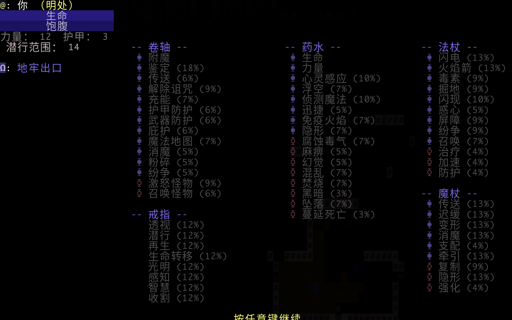

# Brogue CE 中文版

保留 Brogue 原版 ASCII 地牢、动态火焰标题和键鼠操作的简体中文版本，基于 CE 1.15.1。

[下载 Release](https://github.com/Drafffffff/BrogueCE-zh/releases) · [掌机移植分支](https://github.com/Drafffffff/BrogueCE-zh/tree/移植)

| 分支 | 内容 |
| --- | --- |
| **汉化** | 原版桌面游戏 + 中文文本、UTF-8 排版、中文字体；Mac / Linux 键鼠操作 |
| **移植**（当前） | 包含汉化，再增加 RG34XX / NextUI、全手柄操作、掌机镜头与阅读面板 |

## RG34XX / NextUI 安装

下载 `RG34XX-NextUI.zip`，将包中的 `Roms` 文件夹合并到 SD 卡根目录。安装前正常保存并退出 Brogue；覆盖同名程序文件，存档保存在 `.userdata/shared/brogue-rg34xx`，不要删除该目录。启动入口为 **Ports → Brogue**，附封面，标题保留原版动态火焰。

完整按键见 [掌机操作](docs/掌机操作.md)：X 背包、Y 搜索、m 历史、R1 交互信息、L2 自动探索，R2+R1 只读浮窗、L1 五页签、m 消息历史；长按方向和搜索可连续动作。顶部固定两行，生命条为红色。菜单、物品动作、阅读与瞄准均支持手柄。

本分支包含汉化分支的中文文本，并增加独立掌机界面。桌面专用的 Ctrl+Tab 和软件渲染修复不适用于掌机；共用的投掷、怪物说明与目录漏译修复已同步。预发布包已做本地 ARM64 回归；本次共用文本修复尚未完成实机长时间游玩验证。仅以 RG34XX / NextUI 为目标，其他 H700 固件需自行适配。

源码可直接构建；固定工具链与依赖校验、打包脚本见 `packaging/build-rg34xx.py`。安装 Docker 与 Python 3 后，在仓库根目录执行 `python3 packaging/build-rg34xx.py`。输出 `.build/dist`。桌面键鼠版本请使用 `汉化` 分支。

## 桌面汉化版本

- **Mac Apple Silicon**：下载 `macOS-arm64.zip`，将 `Brogue CE 中文.app` 拖入 Applications。当前预编译包要求 **macOS 26 或以上**；已打包动态库，无需 Homebrew。应用为本地签名，未经过 Apple 公证。源码可以在满足依赖的其他 macOS 版本上自行编译。
- **Linux x86_64 / Bazzite**：下载 `Linux-x86_64.tar.gz`，解压 `Brogue` 到 `~/Games/`，执行 `~/Games/Brogue/launch.sh`。保留原版键鼠操作，默认全屏；程序使用系统 SDL2、glibc、FreeType，并附 SDL2_image / SDL2_ttf。已在 Bazzite 44 验证，其他发行版需要相应运行库。
- **Steam**：Linux 包包含封面、竖图、Hero、大透明 Logo 和图标。也可单独下载 `Steam-Artwork.zip`。退出 Steam 后运行 `python3 ~/Games/Brogue/install-steam.py`；有多个 Steam 账户时使用 `--config` 指定账户的 `config` 目录。也可手动添加 `launch.sh` 为非 Steam 游戏并设置图片。
- **RG34XX**：切换到 `移植` 分支，使用独立的 NextUI Release。

## 键鼠操作

方向键 / `hjklyubn` 移动；`s` 搜索，`z` 等待，`x` 自动探索；`i` 背包，`m` 菜单，`M` 消息历史，`?` 帮助，`S` 保存并退出。地牢底部及物品动作按钮显示真实快捷键。

瞄准和观察时，**Tab 下一目标，Ctrl+Tab 上一目标**。保留原版目标筛选规则：投掷卷轴等普通物品不会通过 Tab 自动选择怪物；可以用方向键或鼠标指定位置。Shift+Tab 留给 Steam Overlay。

Mac 存档：`~/Library/Application Support/Brogue/Brogue CE/`。Linux 启动器存档：`${XDG_DATA_HOME:-~/.local/share}/brogue-ce-zh/`。更新时替换程序目录，存档位于独立目录。

## 汉化与验证范围

已覆盖标题、菜单、物品名与详情、物品目录、怪物名字与说明、命中和伤害估计、变异与能力、常用战斗 / 地形事件、状态栏和帮助。药水名称使用公开外观色。不会翻译随机卷轴符文、种子、文件名和用户输入的名称。

本次修复怪物详情 / 睡眠状态 / 坠落提示 / 投掷药水结果 / 物品目录漏译，以及桌面软件渲染关闭中文窗口后留下半字残影的问题。检查了 1,809 组怪物、变异、盟友及俘虏说明；同种子中英文数值一致。仍可能存在未触达场景的漏译，首发标记为预发布，欢迎附截图报告。



## 从源码构建

源码已经包含汉化，无需再次运行适配生成器。Linux 安装 C 编译器、Make、SDL2、SDL2_image 和 SDL2_ttf 开发包后：

```sh
make -j4 RELEASE=YES
cd bin
./brogue
```

macOS 安装同名开发依赖后使用 `make -B MAC_APP=YES RELEASE=YES`，应用打包脚本见 `packaging/`。默认中文，设置 `BROGUE_LANG=en` 可对照原版英文；`BROGUE_CJK_FONT` 可指定字体路径。

上游、许可证与字体来源见 [UPSTREAM.md](UPSTREAM.md) 和 [LICENSE.txt](LICENSE.txt)。

<<<<<<< HEAD
## macOS SDL2 与 Terminal（2026-10-15）

本次提供两个原版键鼠汉化版本：SDL2 图形版保留火焰标题与原版界面；Terminal 版保留 ASCII 地牢并支持中文双宽字符、16 / 256 / 真彩色终端。两者共享 `~/Library/Application Support/Brogue/Brogue CE/` 存档，避免同时打开同一局。预编译包仅支持 Apple Silicon，SDL2 包最低系统版本见 Release。

Terminal 包解压后双击 `Brogue Terminal.command`；终端至少需要 100 列、34 行。也可在已有终端中运行 `Brogue Terminal/launch.sh`。终端中的组合键和鼠标能力取决于终端模拟器；Steam Ctrl+Tab 修改主要针对 SDL2 版本。

从源码构建 Terminal：`make -B -j4 TERMINAL=YES GRAPHICS=NO MAC_APP=NO RELEASE=YES`，需要 ncurses 开发库。Linux 可安装 `libncursesw5-dev` 并在构建时指定 `LDLIBS=-lncursesw`；Mac 使用系统 ncurses，无需 SDL 或中文字体文件。
>>>>>>> 汉化

## 2026-10-15 掌机更新

RG34XX 版本 `07fe1f07` 已安装验证。L2 自动探索；R2+R1 切换浮窗左 / 右 / 关闭，默认右侧；R2+ST 休息。L1 行动菜单，m 消息历史，R1 交互信息。菜单 L1/R1 切签，阅读 L1/R1 翻页。顶部显示明处、阴影、暗处或隐形，遵循原版光照判定，固定两行不挤压地图。
